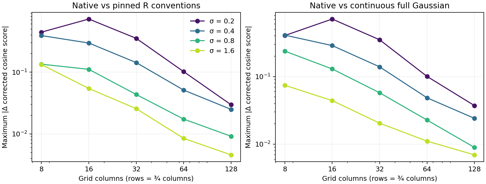

# Density approximation contract

The native Gaussian estimator is a discrete approximation with named grid,
bandwidth and edge conventions. Equal bandwidth numbers alone do not establish
agreement with another KDE implementation. Compare the same coordinates, units,
duration weights, crop, evaluation coordinates, kernel support, normalization and
pair identities before interpreting a score difference.

## Native estimator

`Smoother.gaussian` bins each included weighted point into its containing
half-open grid cell. The kernel acts on that cell's centre, so the coordinate
displacement is at most half a cell on either axis. Each axis uses sampled
Gaussian taps through `max(1, ceil(3 * sigma / cellSize))` cells, normalized by
their discrete sum. The rectangular support therefore changes in whole cells;
it is not a continuous circular three-sigma cutoff. The shared fdlibm exponential
is specified in [numerical reproducibility](NUMERICAL_REPRODUCIBILITY.md).

`EdgePolicy.Truncate` discards kernel mass outside the crop. Converting the
result to a distribution normalizes the remaining total; points near an edge
then contribute less than equally weighted interior points. `Renormalise`
instead corrects each source cell for its retained share before convolution.
These are different edge estimands. The evidence below qualifies **Truncate**.
It does not establish a bound for Renormalise, adaptive bandwidths or rotated
covariance kernels.

Native maps and scores retain binary64 values. There is no seven-digit density
rounding step. Grid refinement changes point quantization, tap support and edge
loss; individual comparisons need not improve monotonically at every resolution.

## Public sensitivity court

The reproducible synthetic cohort contains two participants, three encoding
templates per participant, and matched, mismatching and near-midpoint queries.
The fixed crop is `[-1,7) × [-1,5)`. Every fixation has an explicitly recorded
positive integer duration in microseconds. Points near opposite edges and points
within grid cells exercise binning and boundary behavior. Near-midpoint mixtures
are calibrated with analytic finite-window integrals of products of full Gaussian
kernels, independently checked by 96 × 96 Gauss–Legendre quadrature. They are not
selected by searching native/R score disagreements.

The actual `StudyInput` and `StudyPlan` run on five grids, from 8 × 6 to 128 × 96,
at fixed sigma values 0.2, 0.4, 0.8 and 1.6 in crop units. Pairing uses the matching
encoding stimulus and both other encoding stimuli from the same participant.
The corrected score is matched cosine minus the arithmetic mean of those two
control cosines. No random-control equivalence is assumed. Exact selected keys,
control pools and excluded phases are checked separately from numerical scores.

All native contexts match exactly between JVM and Scala.js, including full maps,
retained totals and corrected scores. Independent direct point-kernel sums check
the maps with absolute tolerance `2e-13` plus relative tolerance `2e-12`; score
checks use absolute and relative tolerance `2e-12`. These are oracle tolerances,
not permitted cross-library approximation errors.

The comparison separates successive changes: undo source-cell quantization;
replace native index support with the reference support window; move evaluation
coordinates from centres to inclusive endpoints; then apply reference rounding.
These signed changes telescope to the final difference. Their attribution depends
on this order and must not be interpreted as independent causal effects.
An additional analytic continuous full-Gaussian score separates approximation
error from differences between two discrete estimators.

Maximum absolute changes in corrected cosine score for this cohort are:

| Sigma | 8 × 6 | 16 × 12 | 32 × 24 | 64 × 48 | 128 × 96 |
|---|---:|---:|---:|---:|---:|
| 0.2 | 0.443725 | 0.723983 | 0.352371 | 0.101857 | 0.029666 |
| 0.4 | 0.390698 | 0.296116 | 0.142775 | 0.051232 | 0.024958 |
| 0.8 | 0.134561 | 0.111112 | 0.043464 | 0.017377 | 0.009165 |
| 1.6 | 0.132820 | 0.054408 | 0.025624 | 0.008478 | 0.004579 |

The independent native-map check has maximum absolute error `2.50e-16`.
Six near-midpoint queries change sign between discrete conventions, including
two at the finest grid. Rounding contributes at most `1.73e-7` to corrected score
in this sweep; binning and evaluation placement account for much larger changes.
These maxima come from different queries and their absolute values must not be
added together. The smallest sigma at the coarsest grid is the estimator's
admissible `sigma = cellSize / 5` boundary, deliberately a stress case.



## Agreement with the pinned R implementation

The reference runner uses the revision and complete R/package lock in
`tools/r-parity`, through its standard package-audited session. It calls public
`eye_density` and `template_similarity` with explicit `ks`, `binned = FALSE`,
`supp = 3.7`, fixed duration weighting, crop and exhaustive controls. Those
settings are this experiment's conventions, not a claim about every library
default.

The reference evaluates inclusive endpoint grids, with the supplied first and
last endpoints stored verbatim. Computing the last coordinate by multiplying a
step can differ by one binary64 unit and can change support membership.
Its unbinned support rectangle
uses the grid point immediately below the lower support bound and the last grid
point at or below the upper bound, as implemented by `ks::find.gridpts`.
It normalizes the map and then applies `zapsmall(..., digits = 7L)`.
In the locked R runtime, that function passes `7 - log10(max(abs(map)))` to
`round`; R rounds this fractional decimal-place count with `floor(digits + 0.5)`.
Replacing it with `7 - floor(log10(maximum))` is incorrect.

All 480 actual R maps, including the full-support comparison maps, equal the
independent rounded direct-sum oracle in this court. Actual matched/control and
corrected R scores agree with independent cosine calculations to maximum
absolute error `1.23e-15`, within the fixed score tolerance. The recorded runtime
is R 4.5.1 on Linux aarch64 with OpenBLAS; the namespace audit verifies every
loaded package against the repository lock. This verifies the staged comparison
model for these inputs, rather than treating another library's output as an
unquestioned oracle.

Full-precision JSON transport is also necessary: the evidence helper writes
17-digit doubles. Its regression test checks exact binary64 transport against
R's binary representation and a support-boundary classification. Original
private receipts are preserved as historical evidence and are not regenerated.

For practical comparisons, keep the cell size small relative to sigma, inspect
edge retention, and repeat the analysis at finer grids. A near-zero corrected
score needs its own sensitivity check; a small absolute discrepancy can change
its sign. Neither this finite cohort nor a cells-per-sigma rule supplies a
universal error bound. Agreement at machine precision is expected only when the
discrete conventions themselves agree.

## Reproduction and evidence

The input and generated portable cases live under
`tools/r-parity/fixtures/cases/density-approximation.json` and the plan test sources.
The direct-sum regression suite runs in ordinary JVM and Scala.js tests. The
larger court is opt-in and emits complete maps for external verification.

Use Python 3.12 with `tools/density-approximation/requirements.txt`. The R runner
requires the existing locked R environment and an eyesim checkout containing the
manifest pin; it installs that pinned Git archive into a temporary library.

```sh
python3 tools/density-approximation/generate_inputs.py --check
python3 tools/density-approximation/generate_regression.py --check
python3 tools/density-approximation/reference.py --eyesim /path/to/eyesim --check
sbt 'planJVM/testOnly eyes4s.plan.DensityApproximationSuite' \
    'planJS/testOnly eyes4s.plan.DensityApproximationSuite'
```

Run the complete native producer with:

```sh
sbt 'planJVM/Test/runMain eyes4s.plan.DensityApproximationCourt' \
    'project planJS' \
    'set Test / mainClass := Some("eyes4s.plan.DensityApproximationCourt")' \
    'set Test / scalaJSUseTestModuleInitializer := false' \
    'set Test / scalaJSUseMainModuleInitializer := true' Test/run > native.log
python3 tools/density-approximation/analyze.py \
    --native-log native.log \
    --reference tools/r-parity/fixtures/density-approximation.json \
    --output analysis.json
python3 tools/density-approximation/summarize.py \
    --analysis analysis.json --output summary.json --figure sensitivity.png
```

The [numerical evidence](evidence/density-approximation-20261014.json) records
per-context score sensitivity, ordered changes, edge retention and sign cases.
The raw-map reference output can be retained outside the repository with the
reference runner's `--retain` option.
